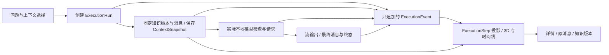

# 统一认知架构 v2（待确认设计）

日期：2026-10-18。本文保留目标设计。2026-10-18 P0-A 已按 refactoring-plan 的“实现细化”落地，其余仍为目标设计。现状以 [gap-analysis.md](gap-analysis.md) 为准。

## 1. 产品边界与复用原则

CortexOS 是本地优先的 AI 认知工作台。聊天是输入/输出入口，知识是可审核的长期资料，图谱是同一批领域实体的探索视图，运行记录回答“本次系统实际做了什么”。Decision Lab 对照固定版本与运行结果；未来模型研究仍独立，不把模型生成解释当作隐藏思维链。

保留 Tauri/Rust/SQLite/React 和当前命令边界。SQLite 保存事实，Rust 决定权限、选取与执行；React 保存导航和瞬时交互，3D 渲染领域数据的投影。保留 `useStudio`、provider、知识事务、编辑器及现有知识图接口，通过小型适配层逐步扩展。

## 2. 统一身份与导航

持久实体继续使用现有 UUID，知识版本使用 `(nodeId, version)`，关系版本使用 `(edgeId, version)`。统一的是引用协议，不是把所有表合并成一张 nodes 表。

建议 `EntityRef` 为带类型的联合：workspace、conversation、message、run、event、knowledgeVersion、relationshipVersion、contextItem，P1 增加 sourceVersion，P2 增加 evaluationResult。每个引用携带 workspaceId 和该类型必要 ID；版本引用必带 version。图节点 `viewId` 可采用 `run:<uuid>:event:<seq>`，领域定位仍保留原引用。演示使用独立 namespace，命令拒绝演示实体。

应用根部维护 `NavigationState {workspaceId, page, graphMode, conversationId?, runId?, selection?, compare?}`；只有当前目的地必需字段进入 hash。例如 `#/graph?workspace=W&mode=execution&run=R&event=3`。使用一个解析器兼容现有 `#/chat` 等路由；非法参数给可恢复错误，Rust 再校验工作区归属。运行流按原 run 更新，导航切换不改变生成归属。

跨页定位动作统一 `navigateTo(EntityRef, destination)`：先验证/载入目标工作区与会话，再定位具体消息或版本，最后滚动/聚焦；保留来源返回位置。选中节点、运行和版本提升到根部；相机拖动、鼠标悬停、表单草稿保持局部。普通导航保留页面筛选；切换工作区清理异工作区选中和旧请求结果。URL 只存 ID 与筛选，不存正文、路径或凭据。

## 3. 运行闭环与事实语义

发送流程分为短事务和外部执行：

1. 基础校验通过后，事务创建运行、输入消息、输出占位和 request_received。输入校验失败保留编辑框，不虚构运行事件。
2. 在一致性读取事务中固定历史消息、用户所选知识的生效版本和正文，记录纳入/排除原因及预算。组装失败追加失败终态；禁止请求模型。
3. 同一事务保存不可变快照及 context_prepared，随后只把该快照的消息序列交给 provider。请求不得另读当前知识，防止审批竞争导致“记录 v1，发送 v2”。
4. 在真实边界追加 model_inspection_started/completed、model_request_started、model_response_received；收到首个内容可追加 first_output_received。HTTP 发起只说明尝试，收到响应才表示服务回应。失败事件保存阶段与可读原因。
5. 保留现有有界输出检查点；终态事务同时保存最终/部分消息、状态和结束事件。取消/完成竞争只产生一个运行终态。重启恢复追加 interrupted，不把恢复时间当作崩溃时刻。
6. 图与详情读取保存的快照、消息和事件。只有实际检索/工具/验证执行发生时，才写对应事件。

现有 `execution_events` 是审计真相，ExecutionStep 是其可重建投影，不另建一套可变“事实”。新事件 payload 采用 schemaVersion、stepId、phase、inputRefs/outputRefs、错误码与摘要。开始和结束事件组成一步；只有开始时为 running，终态失败按真实阶段映射，崩溃时标为 interrupted。尚未执行的计划步骤只能位于明确分隔的“待执行计划”，不混入事实图。旧 run 无明确步骤边界时保留事件序列，未知耗时显示“未记录”。

顺序边 `executed_before` 来自 seq；依赖边 `uses_context/produces/depends_on` 来自显式输入输出引用。时间先后不能自动推导因果。历史 `model_called` 映射为 legacy 调用尝试，不新增成功证据。

## 4. 最小上下文与证据协议

P0 先支持用户在当前工作区显式选取已确认知识；默认选择当前生效版，不自动扫描全部知识。保存会话选择规则时绑定节点 ID，发送时解析到生效版本；预览与发送之间版本变化则要求更新预览再发送。历史实验固定版本的入口留给 Decision Lab。

上下文清单逐项记录：类型、实体 ID/版本、内容哈希、顺序、角色、纳入/排除状态、理由、预算单位和实际快照内容。系统模板与版本、全部实际请求参数、provider/version、模型标签与可取得的 digest 一并固化；字段无法取得时用 unknown，不推测。保留 UTF-8 估算并准确标注单位；精确 token 计数作为后续测量能力。

ContextSnapshot 保存发送的确切 messages 序列及规范化请求元数据，定义 UTF-8/字段排序/哈希算法；快照和请求使用同一构造产物。正文只存本地受控数据库，不进日志。旧运行只拥有 manifest，标记 `manifest_only`；可核对仍在库的消息，但不补造旧系统提示、模型 digest 或完整快照。

区分三层出处：①知识的起源（谁从哪条回答保存）；②本次模型输入纳入的资料；③回答中的声明引用了哪些资料。P0 保证前两层可追溯；明确“纳入上下文”不表示回答已引用或事实已验证。P1 才校验引用标记：引用只能解析到本次 context item，显示对应片段，未知引用标为无效。

P1 引入 FTS5 搜索生效知识和获授权来源。排序、预算、排除原因、所用索引/算法版本写入 retrieval_results 和快照。类型为 hypothesis/conflict 的内容按明确政策单独纳入并标记。资料作为不可信引用内容，不能改写系统权限或触发工具；已确认仍不等于已验证事实。

## 5. 增量数据迁移（设计草案）

迁移序号以实施时仓库为准；现有 0001–0003 校验和保持不变。

| 切片 / 拟迁移 | 最小变化 | 约束与兼容 |
| --- | --- | --- |
| P0-A / 0004_context_audit | 新增 context_snapshots（run 唯一、workspace/conversation/run、schemaVersion、messages/request JSON、hash、created_at）；context_items（snapshot、ordinal、type、message_id 或 node_id/version、content/hash、selection_reason）；按需增加会话上下文选择表 | 只追加快照；消息/知识引用使用明确列、CHECK 和复合 FK。增加必要父键唯一索引。拒绝跨工作区；数量/正文长度限制。旧 run 无快照保持合法；manifest JSON 增加版本化解码，不强行回填。 |
| P0-B / 0005_execution_views | execution_layouts（workspace/run、revision、camera/target）；execution_positions（run、event_id、坐标） | 不修改 knowledge-only 的 graph_layouts；布局绑定真实运行事件并校验归属，保存视图不改事件。ExecutionStep 先计算，无需物化表。 |
| P1 / 0006_sources_retrieval | authorized_sources、sources/source_versions、version_evidence_links、retrieval_results；FTS5 派生索引 | 来源版本+定位+授权范围；证据链接绑定知识版本。FTS 可重建，审批与索引更新事务一致。撤销授权影响未来检索；历史保留/删除先给用户明确选项。 |
| P2 / 后续独立迁移 | comparison_sessions、固定配置/上下文版本集、evaluation_cases及其版本、evaluation_runs/results；workflow_versions | 比较引用既有 run；评估结果只追加，规则版本固定。关系/证据在实验清单中固定具体修订及端点版本。训练另立门槛。 |

为控制规模，P0 仅支持消息和知识 context item，来源引用列随 P1 迁移增加。SQL FK 承担归属，Rust 校验枚举、引用组合、快照哈希和大小；JSON 不替代领域外键。源内容重复储存先用有界快照实现，测得容量问题后再做内容寻址去重。

迁移采用现有 `VACUUM INTO` 备份与事务；验证 integrity_check、foreign_key_check、旧 run 和审批历史逐项一致。失败保留原库与备份。回退用备份及匹配版本应用，不能让旧程序打开新 schema 后猜测兼容。

## 6. 接口与模块变化

| 位置 | 计划变化 | 保留的边界 |
| --- | --- | --- |
| `db.rs::prepare_run`、`commands.rs::generate` | 拆为创建运行、上下文快照、事件追加三个短事务步骤；provider 使用已保存请求 | 继续单生成、事务终态、取消和 checkpoint；不在网络期间持有 DB 锁。 |
| `models.rs`、`studio.ts` | 增加版本化 ContextManifest/Snapshot DTO、EntityRef、ExecutionStep DTO | 兼容旧 RunDetail 字段；旧 JSON 允许缺省，未知事件显示原名/摘要。 |
| `start_chat` | 可选 contextSelection 与 expectedVersion；默认空选择保持现有行为 | 所有 ID 后端重新核验；不接受任意 system prompt 或模型 URL。 |
| `get_run`；新增 `list_runs/get_context_snapshot/load_execution_graph` | run 列表分页；运行详情返回可重放等级与快照引用；图返回实体引用和投影版本 | 读取均带 workspaceId；图节点不是独立知识副本。 |
| 新增 `preview_context` | 显示纳入/排除清单及版本令牌；发送重新校验 | 预览不算执行事件；变化返回需更新预览，保留问题。 |
| 新增 `save_execution_view` | 按 run 保存布局，revision 乐观并发 | 沿用坐标验证，独立于知识布局。 |
| `App/studio/Chat/Graph/Knowledge` | 共享导航引用、消息定位与选中；调用既有编辑器 | 保留表单未保存保护与异步归属检查。 |
| `GraphViewport` | 输入适配为纯展示节点/边，Knowledge/Execution 各自映射 | 不为了复用把执行事件塞入 knowledge_nodes；图模式使用独立语义与布局。 |

## 7. 验证边界

核心不变量：发给 provider 的序列等于保存快照；历史运行始终指向当时版本；审批只影响未来选取；每个执行节点能定位实际事件/输入输出；所有读取与写入均隔离工作区。用捕获请求的本地测试服务核对逐项输入，再做原生真实 Ollama 冒烟。模型措辞不确定，测试优先断言请求与引用事实，不断言任意知识修订必然产生指定自然语言答案。

原审计轮仅提出方案；随后批准的 P0-A 实现与本设计的细化差异见 ADR 0006。其余分阶段门槛见 [refactoring-plan.md](refactoring-plan.md)。
